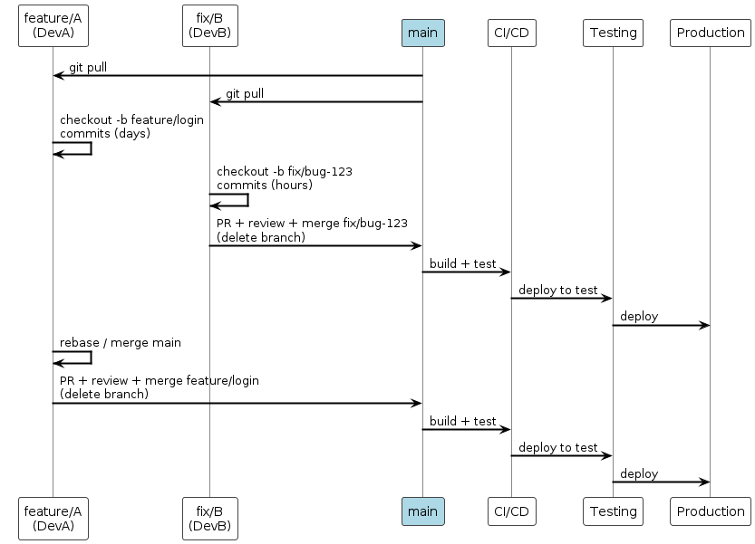
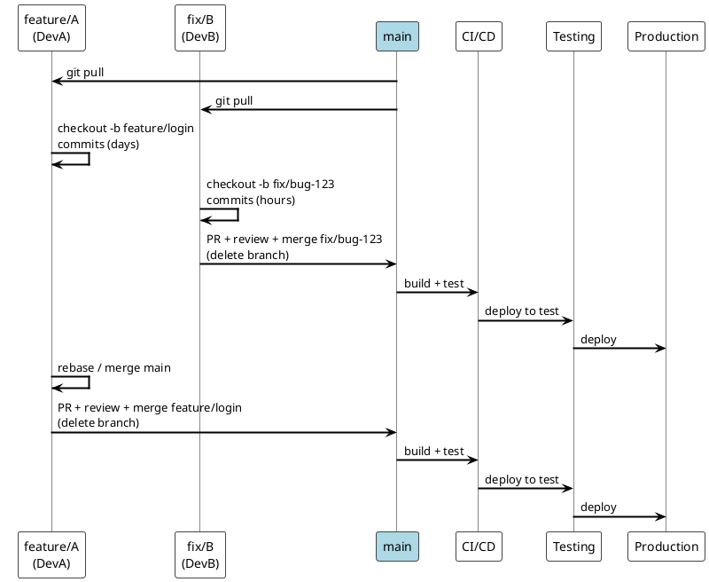
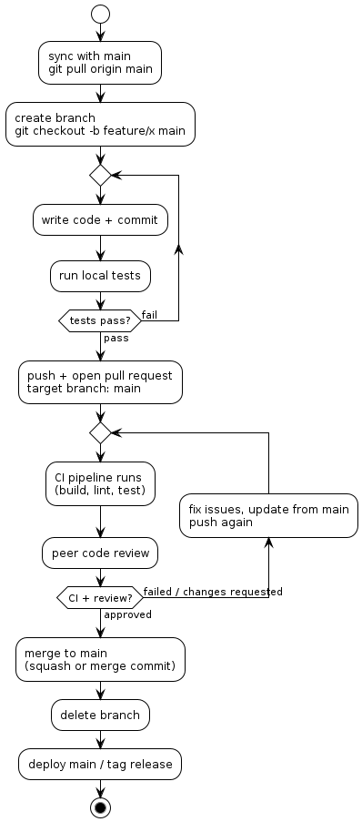
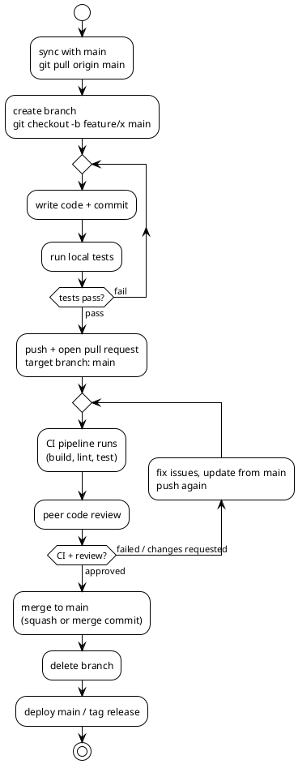

# Branch-Based Workflow (GitHub Flow)

## TOC

- [introduction](#introduction)
- [core principles](#core-principles)
- [branch types](#branch-types)
- [branching model](#branching-model)
- [feature branch workflow](#feature-branch-workflow)
- [branch naming](#branch-naming)
- [hotfixes and releases](#hotfixes-and-releases)
- [comparison](#comparison)
- [when to use it](#when-to-use-it)
- [references](#references)

## Introduction

The branch-based workflow (also known as *GitHub Flow*) builds on the more general [feature branch workflow](git-workflow-feature-branch-based.md) by adding an always-deployable `main` and deployment after every merge. It sits between [GitFlow](git-workflow-gitflow.md) and [trunk-based development](git-workflow-trunk-based.md). There is a single long-lived branch, `main`, and every change — feature, fix or chore — is developed in its own branch and merged back through a pull request.

It keeps the simplicity of trunk-based development (one permanent branch, always deployable) but is more tolerant of branch lifetime and relies on pull-request review as the integration gate rather than on daily merges and feature flags.

## Core Principles

- **`main` is always deployable**: it never contains broken or half-finished work
- **One branch per change**: all work happens in a branch created from `main`
- **Pull request for everything**: no direct commits to `main`; review and CI happen on the PR
- **Merge, then deploy**: once merged, `main` is deployed (or tagged for release) right away
- **Delete after merge**: branches are temporary and removed once merged
- **Descriptive names and small changes**: keep branches focused and reasonably short-lived (days, not weeks)

## Branch Types

| Branch | Lifetime | Branched from | Merged into | Purpose |
|--------|----------|---------------|-------------|---------|
| `main` | permanent | — | — | Production-ready code; protected branch |
| `feature/*` | temporary | `main` | `main` | New features |
| `fix/*` | temporary | `main` | `main` | Bug fixes, including urgent production fixes |
| `chore/*` | temporary | `main` | `main` | Maintenance, dependency updates, docs |

Rules:
- `main` is protected: PR required, CI must pass, at least one approval
- No `develop` or `release` branches; releases are tags on `main`
- Hotfixes follow the same path as any other change, just with higher priority

## Branching Model

The following diagram shows a feature developer and a fix developer working in parallel. Each branch is merged to `main` through a pull request, and every merge is built, tested and deployed through the test environment to production.





## Feature Branch Workflow

Each change is developed in its own branch, branched off `main` and merged back through a pull request.





```bash
git checkout main
git pull origin main
git checkout -b feature/my-feature

# ... work, commit ...

# keep the branch current while the PR is open
git fetch origin
git rebase origin/main        # or: git merge origin/main

git push -u origin feature/my-feature
# open pull request → main

# after merge:
git checkout main
git pull origin main
git branch -d feature/my-feature
git push origin --delete feature/my-feature
```

> Prefer **squash merge** for a linear, one-commit-per-change history on `main`. Use a regular merge commit if the individual commits are worth preserving.

## Branch Naming

```bash
feature/short-description   # new feature
fix/bug-description         # bug fix (including urgent fixes)
chore/task-description      # maintenance, dependency update, docs
```

Optionally include a ticket ID: `feature/PROJ-123-login-form`.

## Hotfixes and Releases

- **Hotfix**: create `fix/critical-bug` from `main`, open a PR flagged urgent, fast-track review, merge, deploy. No separate hotfix branch type and no back-merge, because there is no `develop`.
- **Release**: tag `main` after merge (`git tag -a v1.2.0 -m "Release 1.2.0"`) if versioned releases are needed. Supporting old versions in parallel is outside this model: it needs release branches, described in [branch-based with release branches](git-workflow-branch-with-branches-based.md).
- **Unfinished work**: keep the branch open as a draft PR, or hide it behind a [feature flag](git-workflow-trunk-based.md#feature-flags) if it must be merged early.

## Comparison

| | [Trunk-based](git-workflow-trunk-based.md) | Branch-based | [Branch-based with release branches](git-workflow-branch-with-branches-based.md) | [GitFlow](git-workflow-gitflow.md) |
|---|---|---|---|---|
| Long-lived branches | `main` (+ optional release branches) | `main` | `main` + `release/x.y` | `main`, `develop` |
| Feature branch lifetime | hours to 2 days | hours to days | hours to days | weeks to months |
| Integration gate | CI + small pull requests | pull request + review | pull request + review | pull request into `develop`, then release branch |
| Feature flags | essential | optional | optional | rarely used |
| Release process | continuous from trunk, or from release branches cut from trunk | merge → deploy, or tag `main` | cut `release/x.y` from `main`, tag | `release/*` merged to `main`, tag |
| Fix flow | `main` first, cherry-pick to release branches if any | normal pull request to `main` | `main` first, cherry-pick to release branches | `hotfix/*` merged to `main` + `develop` |
| Parallel supported versions | optional, with release branches | no | yes | only with extra `support/*` branches |
| Back-merges | none | none | none | release and hotfix into `develop` |
| Merge conflict risk | low | low to medium | low to medium | high |
| CI/CD compatibility | excellent | excellent | good | poor |
| Complexity | low | low | medium | high |
| Best for | high deploy frequency, mature CI/CD | continuously deployed apps with code review | versioned software with a few supported versions | scheduled, audited, infrequent releases |

## When to Use It

**Use the branch-based workflow when:**
- You deploy regularly from `main` (daily to weekly)
- Code review via pull requests is part of the team process
- You want a simple model that new contributors understand quickly
- Open source or small-to-mid sized teams contribute through forks/PRs

**Consider another workflow when:**
- Multiple released versions must be supported in parallel → [branch-based with release branches](git-workflow-branch-with-branches-based.md)
- Releases are scheduled, audited and need a dedicated stabilisation phase → [GitFlow](git-workflow-gitflow.md)
- The team has strong automated testing and wants multiple integrations per day → [trunk-based](git-workflow-trunk-based.md)

## References

- [GitHub Flow — GitHub Docs](https://docs.github.com/en/get-started/using-github/github-flow)
- [Atlassian: Git feature branch workflow](https://www.atlassian.com/git/tutorials/comparing-workflows/feature-branch-workflow)
- [Scott Chacon: GitHub Flow (2011)](https://scottchacon.com/2011/08/31/github-flow.html)
