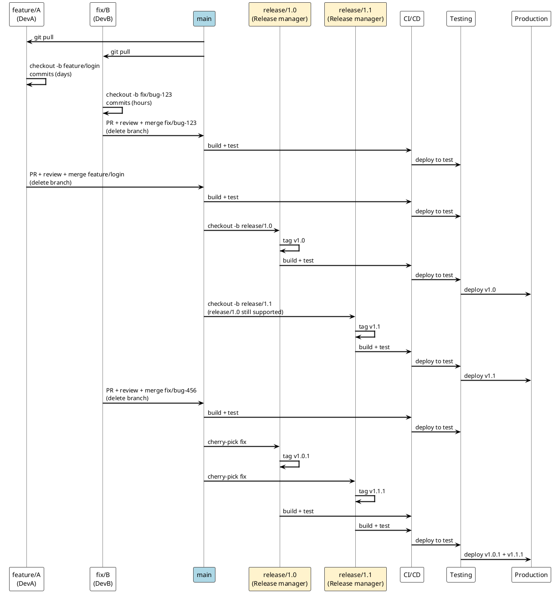
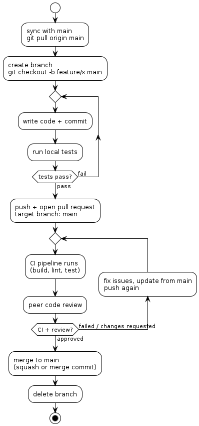
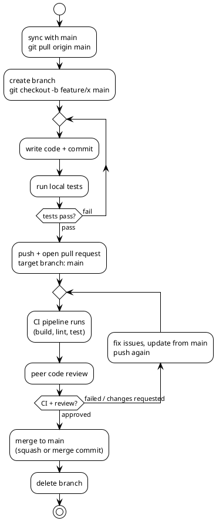
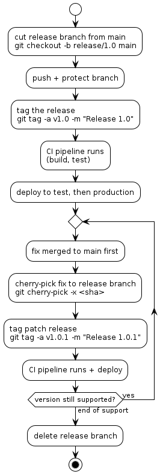
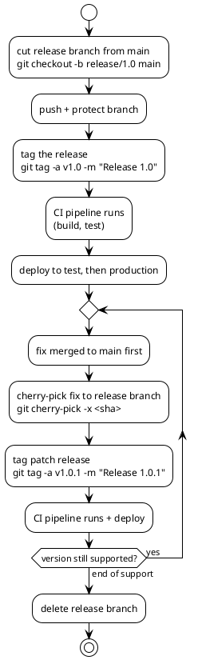
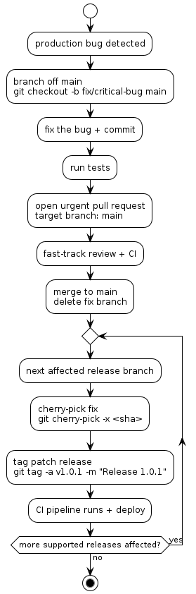
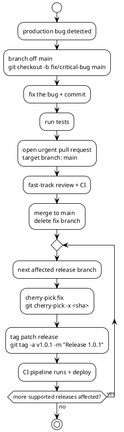

# Branch-Based Workflow with Release Branches

## TOC

- [introduction](#introduction)
- [core principles](#core-principles)
- [branch types](#branch-types)
- [branching model](#branching-model)
- [feature branch workflow](#feature-branch-workflow)
- [release branch workflow](#release-branch-workflow)
- [hotfix workflow](#hotfix-workflow)
- [comparison](#comparison)
- [when to use it](#when-to-use-it)
- [references](#references)

## Introduction

This is the [branch-based workflow](git-workflow-branch-based.md) (GitHub Flow) extended with **release branches**. It is the model known as *GitLab Flow with release branches*. Day-to-day development is identical to the plain branch-based workflow: short-lived feature and fix branches are merged to `main` through pull requests. The difference is that when a version must be shipped and **supported in parallel with newer ones** (v1.x while `main` moves toward v2), a `release/x.y` branch is cut from `main` and maintained separately.

It sits between the plain branch-based workflow and [GitFlow](git-workflow-gitflow.md): it has no `develop` branch and no back-merges, but it supports several released versions at once.

The plain branch-based workflow does not have release branches: `main` is deployed and releases are tags on it. Use this variant only when you actually need to patch old versions.

## Core Principles

- **`main` is the only development branch**: all features and fixes land on `main` first
- **Upstream first**: a fix is always merged to `main` first, then cherry-picked to the affected release branches, so it is never lost in a later version
- **Release branches are cut from `main`, never merged back**: they only receive cherry-picked fixes, no new features
- **Several release branches can be supported in parallel** (e.g. `release/1.0`, `release/1.1`)
- **Every release is a tag** on a release branch (v1.0, v1.0.1)
- **Pull request for everything on `main`**: no direct commits to `main`; release branches only receive cherry-picks of commits already reviewed and merged on `main`
- **Delete at end of support**: a release branch is deleted when its version is no longer supported

## Branch Types

| Branch | Lifetime | Branched from | Merged into | Purpose |
|--------|----------|---------------|-------------|---------|
| `main` | permanent | — | — | Latest development; always deployable; protected branch |
| `feature/*` | temporary | `main` | `main` | New features |
| `fix/*` | temporary | `main` | `main` | Bug fixes, including urgent production fixes |
| `chore/*` | temporary | `main` | `main` | Maintenance, dependency updates, docs |
| `release/x.y` | until end of support | `main` | never merged back | Supported released version; receives cherry-picked fixes only |

Rules:
- `main` is protected: PR required, CI must pass, at least one approval
- `release/*` is protected: only the release manager can push, and only cherry-picks of commits already merged to `main`; CI must pass before tagging
- No `develop` branch; releases are tags on `release/*` branches
- A release branch is never merged back to `main`; fixes flow in one direction: `main` → `release/*`
- Fixes are cherry-picked with `git cherry-pick -x` so the original commit is recorded

## Branching Model

The following diagram shows a feature developer, a fix developer and a release manager working in parallel. The release manager cuts two release branches (`release/1.0`, `release/1.1`) from `main` and patches both by cherry-picking a fix. Merges to `main` are deployed to the test environment only; production is deployed from the release branches.

"Production" stands for what is released to customers: each supported version (v1.0.x, v1.1.x) is its own deployment or download, not one shared environment.




## Feature Branch Workflow

Each change is developed in its own branch, branched off `main` and merged back through a pull request. Release branches are not involved.





```bash
git checkout main
git pull origin main
git checkout -b feature/my-feature

# ... work, commit ...

git push -u origin feature/my-feature
# open pull request → main

# after merge:
git checkout main
git pull origin main
git branch -d feature/my-feature
git push origin --delete feature/my-feature
```

## Release Branch Workflow

When a version must be shipped and supported, the release manager cuts a `release/x.y` branch from `main` and tags it. From then on the branch only receives cherry-picked fixes. Nothing is merged back to `main`.





```bash
git checkout -b release/1.0 main
git push -u origin release/1.0
git tag -a v1.0 -m "Release 1.0"
git push origin v1.0

# later: a fix merged to main, then
git checkout release/1.0
git cherry-pick -x <fix-sha>
git tag -a v1.0.1 -m "Release 1.0.1"
git push origin release/1.0 v1.0.1

# end of support:
git push origin --delete release/1.0
```

> Cut the release branch as late as possible. Until then, ship from `main`.

## Hotfix Workflow

There is no `hotfix/*` branch type. An urgent fix is an ordinary `fix/*` branch with a fast-tracked review. It is merged to `main` first and then cherry-picked to **every** supported release branch that is affected.





```bash
git checkout main
git checkout -b fix/critical-bug

# fix the bug, open PR → main, merge

git checkout release/1.0
git cherry-pick -x <fix-sha>
git tag -a v1.0.1 -m "Release 1.0.1"

git checkout release/1.1
git cherry-pick -x <fix-sha>
git tag -a v1.1.1 -m "Release 1.1.1"
```

> If the bug exists only in an old release and no longer on `main`, fix it directly on the release branch through a PR. This is the only case where `main` is skipped.

## Comparison

| | [Trunk-based](git-workflow-trunk-based.md) | [Branch-based](git-workflow-branch-based.md) | Branch-based with release branches | [GitFlow](git-workflow-gitflow.md) |
|---|---|---|---|---|
| Long-lived branches | `main` (+ optional release branches) | `main` | `main` + `release/x.y` | `main`, `develop` |
| Feature branch lifetime | hours to 2 days | hours to days | hours to days | weeks to months |
| Integration gate | CI + small pull requests | pull request + review | pull request + review | pull request into `develop`, then release branch |
| Feature flags | essential | optional | optional | rarely used |
| Release process | continuous from trunk, or from release branches cut from trunk | merge → deploy, or tag `main` | cut `release/x.y` from `main`, tag | `release/*` merged to `main`, tag |
| Fix flow | `main` first, cherry-pick to release branches if any | normal pull request to `main` | `main` first, cherry-pick to release branches | `hotfix/*` merged to `main` + `develop` |
| Parallel supported versions | optional, with release branches | no | yes | only with extra `support/*` branches |
| Back-merges | none | none | none | release and hotfix into `develop` |
| Merge conflict risk | low | low to medium | low to medium | high |
| CI/CD compatibility | excellent | excellent | good | poor |
| Complexity | low | low | medium | high |
| Best for | high deploy frequency, mature CI/CD | continuously deployed apps with code review | versioned software with a few supported versions | scheduled, audited, infrequent releases |

## When to Use It

**Use this workflow when:**
- You ship versioned software and must patch older versions (libraries, agents, on-premise products)
- You want the simplicity of a single development branch but cannot deploy only the latest `main`
- You do not want GitFlow's `develop` branch and back-merges

**Consider another workflow when:**
- You only ever deploy the latest `main` → [branch-based](git-workflow-branch-based.md) or [trunk-based](git-workflow-trunk-based.md)
- Releases are scheduled, audited and need a dedicated stabilisation phase → [GitFlow](git-workflow-gitflow.md)

## References

- [GitLab Flow](https://about.gitlab.com/topics/version-control/what-is-gitlab-flow/)
- [trunkbaseddevelopment.com: release from branch](https://trunkbaseddevelopment.com/branch-for-release/)
