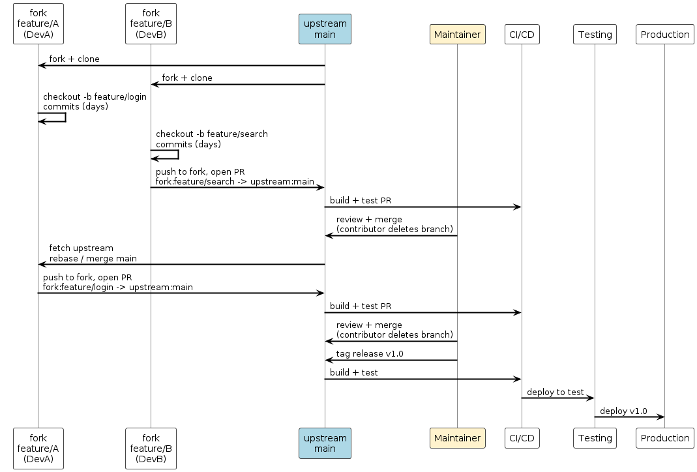
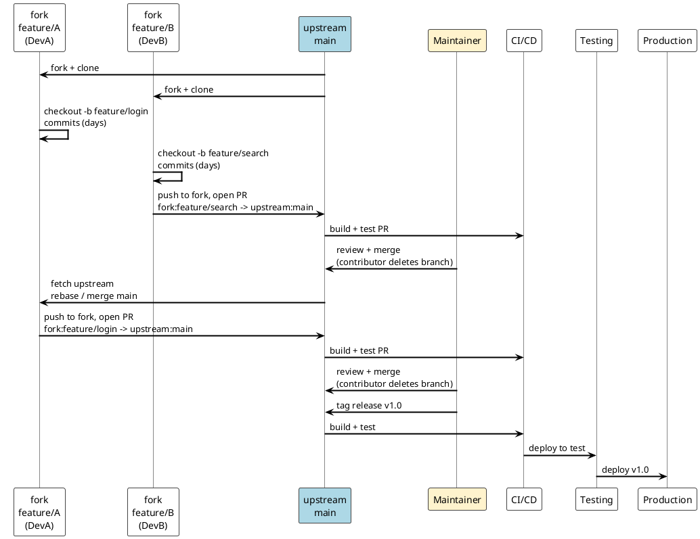
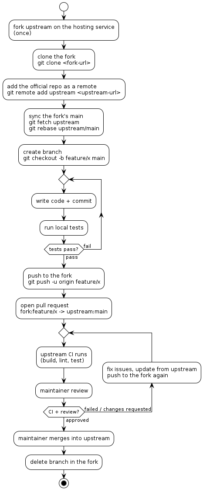
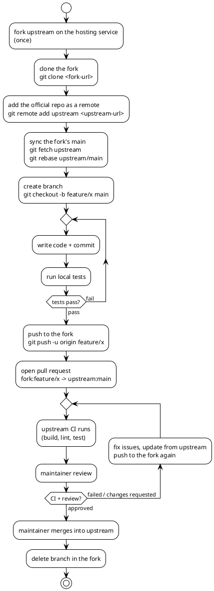

# Forking Workflow

## TOC

- [introduction](#introduction)
- [core principles](#core-principles)
- [repositories and branches](#repositories-and-branches)
- [workflow](#workflow)
- [contributor workflow](#contributor-workflow)
- [keeping the fork in sync](#keeping-the-fork-in-sync)
- [maintainer side](#maintainer-side)
- [relation to other workflows](#relation-to-other-workflows)
- [when to use it](#when-to-use-it)
- [references](#references)

## Introduction

In the forking workflow every contributor has a personal server-side copy of the project, a *fork*, and pushes only there. The official repository, called `upstream`, receives changes only when a maintainer accepts a pull request (merge request in GitLab) from a fork.

It is the standard way to contribute to open source projects, because contributions can be accepted from anyone without giving them write access to the official repository.

The forking workflow is **not a branching model**. It decides where branches live, and says nothing about how `upstream` is organised or released. Inside a fork, contributors normally use the [feature branch workflow](git-workflow-feature-branch-based.md), and `upstream` can follow any of the other workflows. Atlassian notes that the forking workflow "typically follows a branching model based on the Gitflow Workflow".

## Core Principles

- **Contributors have no write access to `upstream`**: they push only to their own fork
- **Pull request across repositories**: the change travels from a branch in the fork to a branch in `upstream`
- **Only maintainers merge into `upstream`**
- **Forks stay connected to `upstream`**: contributors fetch from it to stay current
- **Work in a branch, not in the fork's `main`**: the fork's `main` is kept as a clean mirror of `upstream/main`

## Repositories and Branches

| Repository | Who can push | Contains | Remote name in a local clone |
|---|---|---|---|
| `upstream` (official) | maintainers only | the project's real branches (`main`, plus release branches if it has any) | `upstream` |
| fork | its owner | a copy of `upstream` plus the owner's working branches | `origin` |
| local clone | its owner | clone of the fork | — |

| Branch | Where | Lifetime | Branched from | Merged into |
|---|---|---|---|---|
| `main` | `upstream` and the fork | permanent | — | — |
| `feature/*` | the fork only | temporary | `upstream/main` (via the fork's `main`) | `upstream/main`, by pull request |

Rules:
- Never push to `upstream` from a contributor clone; set the push URL to a dummy value to prevent it (Kubernetes uses `git remote set-url --push upstream no_push`)
- Branches are created in the fork and are deleted after the pull request is merged
- The pull request target is the `upstream` branch, normally `main`

## Workflow

The following diagram shows two contributors, each with their own fork, working in parallel. Neither can push to `upstream`; a maintainer reviews and merges each pull request, and `upstream` CI builds and tests the result. Releases are outside the forking workflow and follow whatever model `upstream` uses; the diagram shows them as a separate step.





## Contributor Workflow





```bash
# once: fork upstream on the hosting service, then
git clone git@github.com:YOU/project.git
cd project
git remote add upstream https://github.com/OWNER/project.git
git remote set-url --push upstream no_push     # never push to upstream
git remote -v

# for every change
git fetch upstream
git checkout main
git rebase upstream/main
git checkout -b feature/my-feature

# ... work, commit ...

git push -u origin feature/my-feature
# open pull request: YOU:feature/my-feature -> OWNER:main

# after merge:
git checkout main
git fetch upstream
git rebase upstream/main
git push origin main                           # update the fork
git branch -d feature/my-feature
git push origin --delete feature/my-feature
```

## Keeping the Fork in Sync

A fork does not update itself. Sync it before starting a new branch and while a pull request is open:

- **Command line**: `git fetch upstream` then `git rebase upstream/main` (or `git merge upstream/main`), then `git push origin main`
- **GitHub web UI**: the *Sync fork* dropdown on the fork's page
- **GitHub CLI**: `gh repo sync OWNER/fork -b main`

If upstream changes cause conflicts, resolve them in your branch, not in `upstream`.

## Maintainer Side

Maintainers work on `upstream` and follow whatever workflow the project defines:

- review the pull request, request changes, run or watch CI
- merge (squash, merge commit or rebase) into `upstream/main`
- cut releases from `upstream` (tag `main`, or cut release branches; see [branch-based with release branches](git-workflow-branch-with-branches-based.md))
- maintainers with write access can use ordinary branches in `upstream` and do not need a fork; GitLab's documentation states this explicitly

## Relation to Other Workflows

| | Forking | [Feature branch](git-workflow-feature-branch-based.md) / [Branch-based](git-workflow-branch-based.md) |
|---|---|---|
| What it defines | where branches live and who can merge | how changes are isolated and merged |
| Write access to the official repo | maintainers only | every developer |
| Where the working branch lives | contributor's fork | the official repo |
| Pull request | across repositories | within one repository |
| Branch creation | in the fork | in the official repo |
| Typical use | open source, external contributors, untrusted contributors | internal teams |
| Extra overhead | fork setup and keeping the fork in sync | none |

The forking workflow is combined with other workflows, not an alternative to them:
- feature branch and [GitHub Flow](git-workflow-branch-based.md) inside the fork, which is the most common case
- [Trunk-based](git-workflow-trunk-based.md), [GitFlow](git-workflow-gitflow.md) or [release branches](git-workflow-branch-with-branches-based.md) on `upstream`

## When to Use It

**Use the forking workflow when:**
- Contributors should not have write access to the official repository (open source, external contributors, vendors)
- You want a clear review gate with no way around it, because only maintainers can merge
- Contributors work with their own tooling, environments or experiments that should not clutter the official repository

**Do not use it when:**
- All developers are in one team with write access: branches in the official repository are simpler, and need no fork syncing
- Fast, daily integration is needed: the extra repository and sync step slow small, frequent changes down, so [trunk-based](git-workflow-trunk-based.md) normally runs inside one repository

## References

- [Atlassian: Forking workflow](https://www.atlassian.com/git/tutorials/comparing-workflows/forking-workflow)
- [GitHub Docs: About forks](https://docs.github.com/en/pull-requests/collaborating-with-pull-requests/working-with-forks/about-forks)
- [GitHub Docs: Syncing a fork](https://docs.github.com/en/pull-requests/collaborating-with-pull-requests/working-with-forks/syncing-a-fork)
- [GitLab Docs: Forks](https://docs.gitlab.com/user/project/repository/forking_workflow/)
- [Pro Git: Distributed Workflows (integration-manager workflow)](https://git-scm.com/book/en/v2/Distributed-Git-Distributed-Workflows)
- [Pro Git: Contributing to a Project on GitHub](https://git-scm.com/book/en/v2/GitHub-Contributing-to-a-Project)
- [Kubernetes: GitHub workflow](https://www.kubernetes.dev/docs/guide/github-workflow/)
