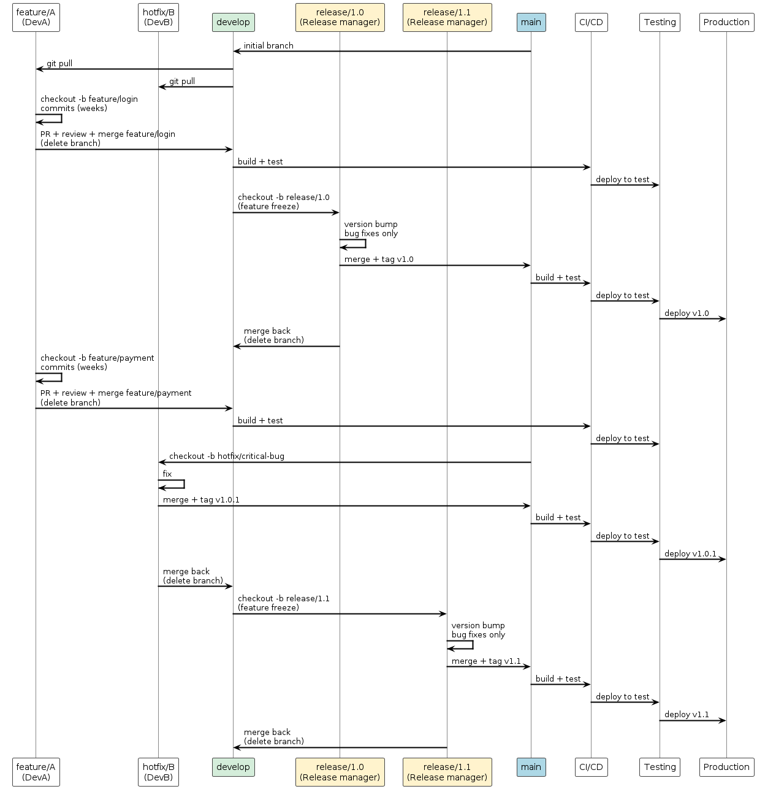
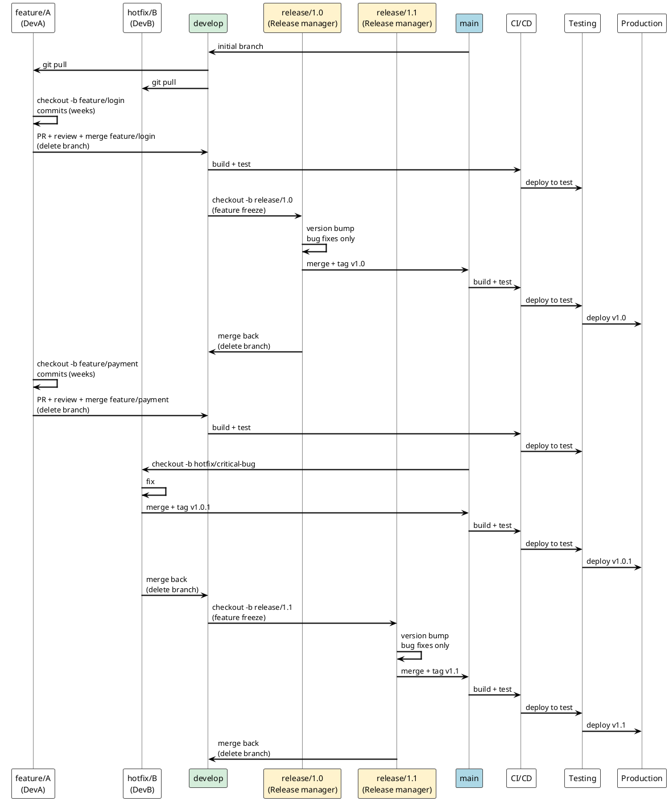
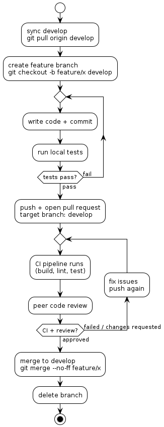
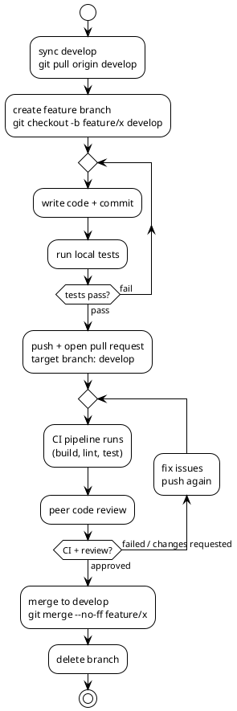
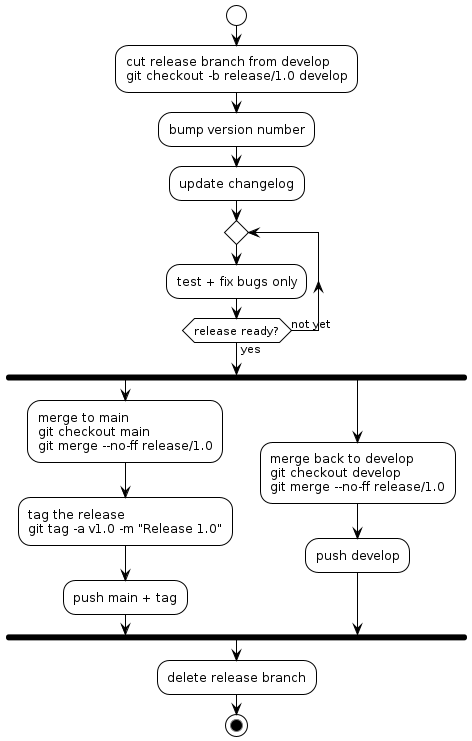
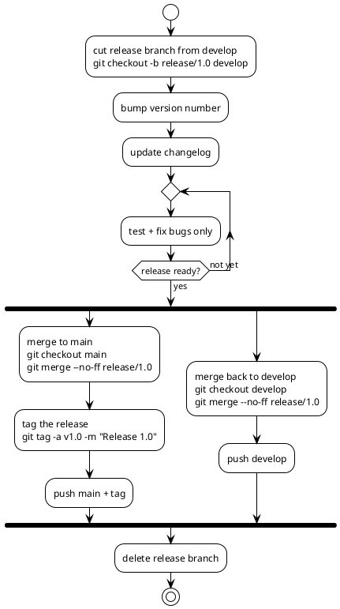
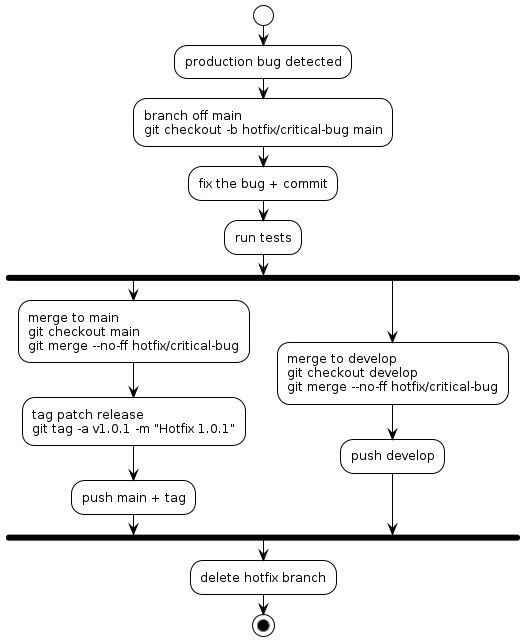
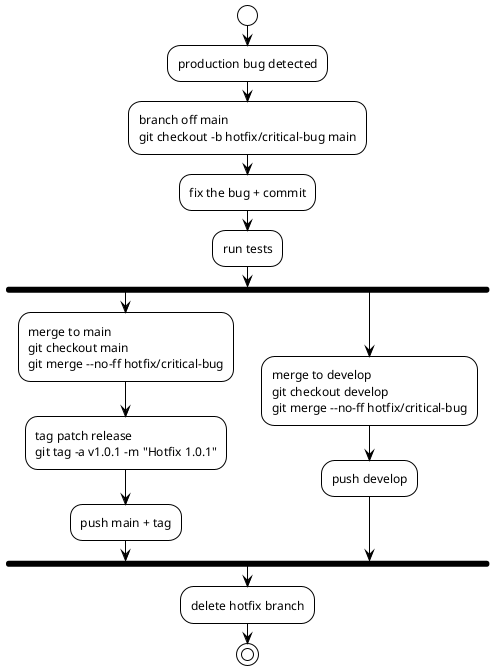

# GitFlow Workflow

## TOC

- [introduction](#introduction)
- [branch types](#branch-types)
- [branching model](#branching-model)
- [feature branch workflow](#feature-branch-workflow)
- [release branch workflow](#release-branch-workflow)
- [hotfix workflow](#hotfix-workflow)
- [when to use gitflow](#when-to-use-gitflow)
- [comparison](#comparison)
- [references](#references)

## Introduction

GitFlow is a branching model designed for projects with scheduled, versioned releases. It was introduced by Vincent Driessen in 2010. It defines a strict branching structure with dedicated branches for features, releases, and hotfixes.

GitFlow is well-suited for software that ships discrete versions (libraries, desktop apps, mobile apps). It is generally **not recommended** for web services with continuous deployment — for those, prefer [trunk-based development](git-workflow-trunk-based.md) or the [branch-based workflow](git-workflow-branch-based.md).

## Branch Types

GitFlow has two permanent branches, `main` and `develop`. This split is the defining feature of the model (Vincent Driessen's original article calls them `master` and `develop`):

- **`main`** holds released code. Every commit on it is a tagged release (v1.0, v1.0.1), so it always reflects what is or was in production.
- **`develop`** is the integration branch. Finished features land there, so it holds the latest delivered work for the next release.

The two branches are the reason GitFlow is heavier than [trunk-based](git-workflow-trunk-based.md) or [branch-based](git-workflow-branch-based.md) workflows, which have only `main`, and the reason every release and hotfix must be merged back to **both** branches. In many teams `develop` is built and deployed to a test or staging environment, while only `main` is deployed to production.

| Branch | Lifetime | Branched from | Merged into | Purpose |
|--------|----------|---------------|-------------|---------|
| `main` | permanent | — | — | Production-ready code; every commit is a release |
| `develop` | permanent | `main` | — | Integration branch; latest delivered development |
| `feature/*` | temporary | `develop` | `develop` | New features |
| `release/*` | temporary | `develop` | `main` + `develop` | Release preparation; only bug fixes allowed |
| `hotfix/*` | temporary | `main` | `main` + `develop` | Urgent production fixes |

Rules:
- `main` is always tagged with a version number at each merge
- No direct commits to `main` or `develop`
- `feature` branches never interact with `main`
- Both `release` and `hotfix` branches must be merged back to **both** `main` and `develop`

## Branching Model

The following diagram shows a feature developer, a hotfix developer and a release manager working with GitFlow across the full lifecycle of all branch types: feature, release and hotfix branches, and the resulting deployments. Builds of `develop` are deployed to the test environment only; production is deployed from `main`.





## Feature Branch Workflow

Each new feature lives in its own branch, branched off `develop` and merged back when complete.





```bash
git checkout develop
git pull origin develop
git checkout -b feature/my-feature

# ... work, commit ...

git push origin feature/my-feature
# open pull request → develop

# after merge:
git branch -d feature/my-feature
git push origin --delete feature/my-feature
```

> Use `--no-ff` (no fast-forward) when merging features to preserve branch history in the graph.

## Release Branch Workflow

When `develop` has enough features for a release, a `release` branch is cut. Only bug fixes and release preparation (version bumps, changelog) are allowed — no new features.





```bash
git checkout develop
git checkout -b release/1.0

# bump version, update CHANGELOG, fix bugs only

git checkout main
git merge --no-ff release/1.0
git tag -a v1.0 -m "Release 1.0"

git checkout develop
git merge --no-ff release/1.0

git branch -d release/1.0
```

## Hotfix Workflow

Hotfixes address critical production bugs that cannot wait for the next planned release. They branch from `main` (not `develop`) and must be merged back to **both** `main` and `develop`.





```bash
git checkout main
git checkout -b hotfix/critical-bug

# fix the bug

git checkout main
git merge --no-ff hotfix/critical-bug
git tag -a v1.0.1 -m "Hotfix 1.0.1"

git checkout develop
git merge --no-ff hotfix/critical-bug

git branch -d hotfix/critical-bug
```

> If a `release` branch currently exists, merge the hotfix into that instead of `develop` — it will flow into `develop` when the release is completed.

## When to Use GitFlow

**Use GitFlow when:**
- The project ships discrete, versioned releases (v1.0, v1.1, v2.0)
- A regulated or audited release process is required
- The team ships infrequently (monthly, quarterly)

**Do NOT use GitFlow when:**
- The project deploys continuously to production
- The team merges to main multiple times per day
- You want simple CI/CD — the multi-branch model makes pipelines complex
- Several released versions must be supported in parallel (v1.x and v2.x) — core GitFlow has one release line and needs extra `support/*` branches for this; see [branch-based with release branches](git-workflow-branch-with-branches-based.md)

See [trunk-based](git-workflow-trunk-based.md), [branch-based](git-workflow-branch-based.md) and [branch-based with release branches](git-workflow-branch-with-branches-based.md) for the alternatives.

## Comparison

| | [Trunk-based](git-workflow-trunk-based.md) | [Branch-based](git-workflow-branch-based.md) | [Branch-based with release branches](git-workflow-branch-with-branches-based.md) | GitFlow |
|---|---|---|---|---|
| Long-lived branches | `main` (+ optional release branches) | `main` | `main` + `release/x.y` | `main`, `develop` |
| Feature branch lifetime | hours to 2 days | hours to days | hours to days | weeks to months |
| Integration gate | CI + small pull requests | pull request + review | pull request + review | pull request into `develop`, then release branch |
| Feature flags | essential | optional | optional | rarely used |
| Release process | continuous from trunk, or from release branches cut from trunk | merge → deploy, or tag `main` | cut `release/x.y` from `main`, tag | `release/*` merged to `main`, tag |
| Fix flow | `main` first, cherry-pick to release branches if any | normal pull request to `main` | `main` first, cherry-pick to release branches | `hotfix/*` merged to `main` + `develop` |
| Parallel supported versions | optional, with release branches | no | yes | only with extra `support/*` branches |
| Back-merges | none | none | none | release and hotfix into `develop` |
| Merge conflict risk | low | low to medium | low to medium | high |
| CI/CD compatibility | excellent | excellent | good | poor |
| Complexity | low | low | medium | high |
| Best for | high deploy frequency, mature CI/CD | continuously deployed apps with code review | versioned software with a few supported versions | scheduled, audited, infrequent releases |

## References

- [A successful Git branching model — Vincent Driessen (2010)](https://nvie.com/posts/a-successful-git-branching-model/)
- [Atlassian: Gitflow workflow](https://www.atlassian.com/git/tutorials/comparing-workflows/gitflow-workflow)
- [git-flow CLI tool](https://github.com/nvie/gitflow)
- [Vincent Driessen's note (2020): consider trunk-based for web projects](https://nvie.com/posts/a-successful-git-branching-model/#a-note-of-reflection)
