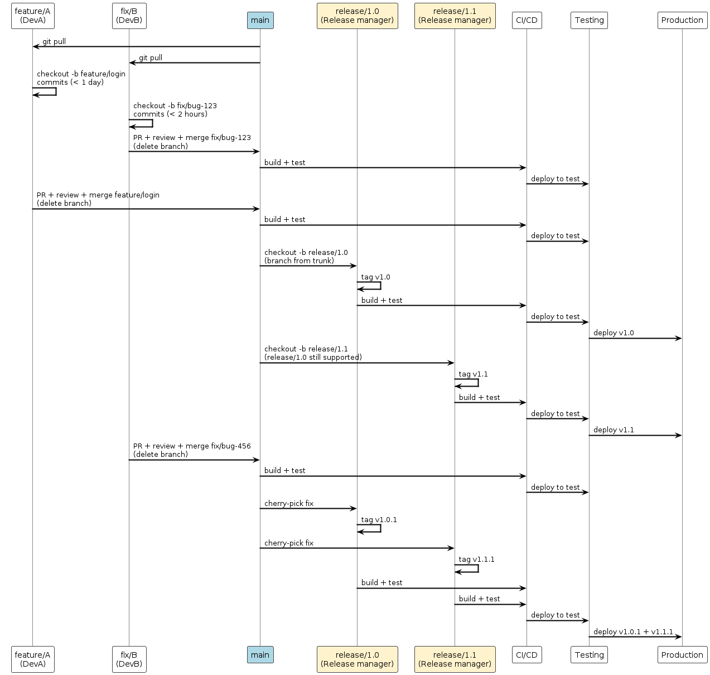
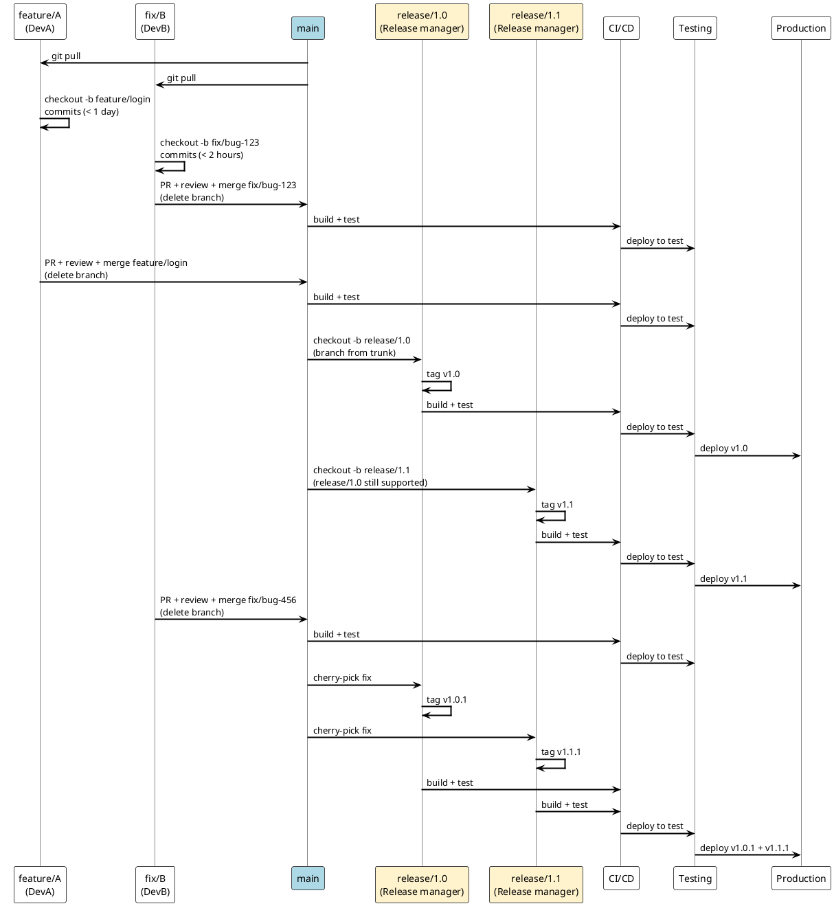
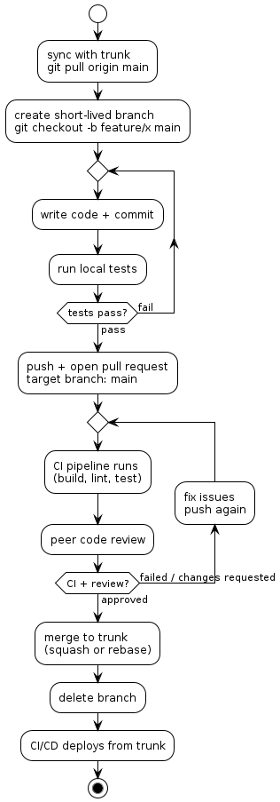
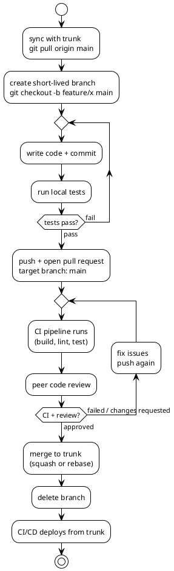

# Trunk-Based Development Workflow

## TOC

- [introduction](#introduction)
- [core principles](#core-principles)
- [branch types](#branch-types)
- [branching model](#branching-model)
- [feature branch workflow](#feature-branch-workflow)
- [release branches](#release-branches)
- [feature flags](#feature-flags)
- [comparison](#comparison)
- [branch naming](#branch-naming)
- [when to use it](#when-to-use-it)
- [references](#references)

## Introduction

Trunk-based development (TBD) is a branching model where all developers integrate into a single shared branch — the "trunk" (`main` or `master`). Feature branches are short-lived (hours to at most 2 days) and merged back to trunk frequently.

It is the foundation for true Continuous Integration: if developers are not merging to trunk daily, they are not doing CI.

Key insight: long-lived branches are the root cause of merge conflicts, integration pain, and slow delivery. TBD eliminates them.

## Core Principles

- **Single trunk**: `main` is the only long-lived development branch (optional release branches are cut from it and never merged back)
- **Short-lived branches**: feature branches live hours to 2 days maximum
- **Always releasable**: trunk must pass all tests and be deployable at any point in time
- **Feature flags**: hide incomplete work behind flags instead of using long-lived branches
- **Automated CI/CD**: build, test, and deploy on every merge to trunk (to production when releasing continuously, to a test environment when releasing from release branches)

## Branch Types

| Branch | Lifetime | Branched from | Merged into | Purpose |
|--------|----------|---------------|-------------|---------|
| `main` (trunk) | permanent | — | — | Single shared branch; always releasable; protected branch |
| `feature/*`, `fix/*`, `chore/*` | hours to 2 days | `main` | `main` | Small changes, merged at least daily |
| `release/x.y` (optional) | until end of support | `main` | never merged back | Supported released version; receives cherry-picked fixes only |

## Branching Model

The following diagram shows a feature developer, a fix developer and a release manager working in parallel. Both developer branches are short-lived and merge to trunk independently; every merge is built, tested and deployed to the test environment. The diagram shows the *branch for release* style: the release manager cuts release branches from trunk, which are maintained in parallel and patched by cherry-picking fixes from trunk, and production is deployed from those branches. Teams that release continuously skip the release branches and deploy every trunk build to production instead.

"Production" stands for what is released to customers: each supported version (v1.0.x, v1.1.x) is its own deployment or download, not one shared environment.





## Feature Branch Workflow

Each change is developed in a short-lived branch off trunk and merged back through a small pull request, usually within a day.





## Release Branches

Teams that deploy continuously release straight from trunk. Teams that ship versioned software (or need to support several versions at once) use **release branches**, which are cut from trunk and are never merged back:

- A release manager cuts `release/x.y` from trunk at a chosen commit (or when the release is ready) and tags it
- Several release branches can exist and be supported in parallel (e.g. `release/1.0` and `release/1.1`)
- Fixes are always made **on trunk first**, then cherry-picked to every affected release branch (`git cherry-pick -x <sha>`) and tagged as a patch release (v1.0.1)
- No new features go into a release branch, and nothing is merged back to trunk
- Release branches are deleted when the version reaches end of support

```bash
git checkout -b release/1.0 main        # cut from trunk
git tag -a v1.0 -m "Release 1.0"

# later: fix merged to main first, then
git checkout release/1.0
git cherry-pick -x <fix-sha>
git tag -a v1.0.1 -m "Release 1.0.1"
```

## Feature Flags

For work that takes longer than 1–2 days, use feature flags to hide incomplete code on trunk rather than keeping a long-lived branch:

```python
if feature_flag("new-checkout-flow"):
    show_new_checkout()
else:
    show_old_checkout()
```

This allows merging to trunk continuously without exposing unfinished features to users. The flag is removed once the feature is complete and validated in production.

Tooling: LaunchDarkly, Unleash, Flipt, or simple environment-variable flags.

## Comparison

| | Trunk-based | [Branch-based](git-workflow-branch-based.md) | [Branch-based with release branches](git-workflow-branch-with-branches-based.md) | [GitFlow](git-workflow-gitflow.md) |
|---|---|---|---|---|
| Long-lived branches | `main` (+ optional release branches) | `main` | `main` + `release/x.y` | `main`, `develop` |
| Feature branch lifetime | hours to 2 days | hours to days | hours to days | weeks to months |
| Integration gate | CI + small pull requests | pull request + review | pull request + review | pull request into `develop`, then release branch |
| Feature flags | essential | optional | optional | rarely used |
| Release process | continuous from trunk, or from release branches cut from trunk | merge → deploy, or tag `main` | cut `release/x.y` from `main`, tag | `release/*` merged to `main`, tag |
| Fix flow | `main` first, cherry-pick to release branches if any | normal pull request to `main` | `main` first, cherry-pick to release branches | `hotfix/*` merged to `main` + `develop` |
| Parallel supported versions | optional, with release branches | no | yes | only with extra `support/*` branches |
| Back-merges | none | none | none | release and hotfix into `develop` |
| Merge conflict risk | low | low to medium | low to medium | high |
| CI/CD compatibility | excellent | excellent | good | poor |
| Complexity | low | low | medium | high |
| Best for | high deploy frequency, mature CI/CD | continuously deployed apps with code review | versioned software with a few supported versions | scheduled, audited, infrequent releases |

## Branch Naming

```bash
feature/short-description   # new feature (max 2 days)
fix/bug-description         # bug fix
chore/task-description      # maintenance, dependency update
```

## When to Use It

**Use trunk-based development when:**
- You deploy frequently (daily or several times per day)
- Automated tests are strong enough to keep trunk always releasable
- The team is ready to use feature flags for unfinished work

**Consider another workflow when:**
- Changes need days of work or review before they can be merged → [branch-based](git-workflow-branch-based.md)
- You mainly ship versioned software and patch old versions → [branch-based with release branches](git-workflow-branch-with-branches-based.md)
- Releases are scheduled, audited and need a dedicated stabilisation phase → [GitFlow](git-workflow-gitflow.md)

## References

- [trunkbaseddevelopment.com](https://trunkbaseddevelopment.com/)
- [DORA: State of DevOps report](https://dora.dev/research/)
- [Atlassian: trunk-based development](https://www.atlassian.com/continuous-delivery/continuous-integration/trunk-based-development)
- [Martin Fowler: feature flags](https://martinfowler.com/articles/feature-toggles.html)
- [Martin Fowler: patterns for managing source code branches](https://martinfowler.com/articles/branching-patterns.html)
- [trunkbaseddevelopment.com: branch for release](https://trunkbaseddevelopment.com/branch-for-release/)
